# C4 Component Diagram (внутри контейнера API Service)

Диаграмма уровня **C4 Component** детализирует внутренние компоненты микросервиса, их интерфейсы (порты) и пошаговый порядок обработки входящего запроса (`1` → `9`).

```mermaid
C4Component
    title API Service — C4 Component Diagram & Execution Sequence

    Container_Boundary(apiBoundary, "Review Classifier Microservice (JVM Process)") {
        Component(httpServer, "ReviewHttpServer", "JDK HttpServer + Virtual Threads", "Маршрутизация /api/v1/reviews/classify, /health/*, /metrics, /actuator/prometheus и fallback 404")
        Component(classifyHandler, "ClassifyReviewHandler", "Inbound HTTP Controller", "1. Проверяет путь/POST (Allow), лимит тела (64 КБ), Semaphore; 9. Отдаёт JSON-ответ и фиксирует http_request_duration_ms")
        Component(reqParser, "ReviewRequestParser", "Strict Jackson Parser", "2. Десериализует без coercion, проверяет канонический UUID и не отражает сырые значения в ошибки 400")
        Component(opsHandlers, "HealthHandler & MetricsHandler", "Operational Controllers", "Отдают Liveness/Readiness (200/503) и Prometheus exposition")

        Component(useCase, "ClassifyReviewUseCase", "Application Use Case", "3. Оркестрирует пайплайн обработки и таймаут инференса (500 мс)")
        Component(domainValidator, "ReviewValidator", "Domain Service", "Проверяет рейтинг 1..5, длину текста 1..5000, non-blank поля")
        Component(piiMasker, "PiiMasker", "Domain Service", "4. Маскирует телефоны, email и имена в [PHONE]/[EMAIL]/[NAME] до модели и логов")
        Component(nlpCore, "TextPreprocessor + Scoring + IssueDetector + Criticality", "Domain Services", "6. Нормализует (ё->е), считает score по весам модели, выделяет DEFECT/DELIVERY_ISSUE и оценивает критичность")

        Component(weightsAdapter, "JsonModelWeightsLoader + ModelWeightsValidator", "Implements ModelWeightsPort", "5. Предоставляет immutable Map весов; проверка SHA-256 и реальный wall-clock дедлайн загрузки <= 10с")
        Component(qaAdapter, "RetryableQaAdapter + DurableOutboxQueue + FileOutboxStore + HttpIncidentSender", "Implements QualityAssurancePort", "7. При isCritical=true персистит IncidentCardDto и ставит асинхронную доставку в QA + контроль 15-мин SLA")
        Component(auditLogger, "JsonStdoutAuditLogger", "Implements AuditLogPort", "8a. Пишет однострочный JSON AuditEvent без ПДн через AUDIT_ASYNC")
        Component(metricsAdapter, "PrometheusMetricsAdapter", "Implements MetricsPort & MetricsExporter", "8b. Обновляет счётчики, гистограммы latency и gauges очереди")
    }

    System_Ext(qaExt, "Quality Assurance Service", "HTTPS/HTTP QA Endpoint")
    System_Ext(stdoutLogs, "Stdout / Logback AUDIT_ASYNC", "Non-blocking Audit Stream")

    Rel(httpServer, classifyHandler, "1. Диспетчеризует POST /api/v1/reviews/classify", "HttpExchange")
    Rel(httpServer, opsHandlers, "Диспетчеризует /health/*, /metrics, /actuator/prometheus", "HttpExchange")
    Rel(classifyHandler, reqParser, "2. Парсит и валидирует строгий JSON", "parse(rawBody)")
    Rel(classifyHandler, useCase, "3. Передаёт ReviewInput", "execute(ReviewInput)")

    Rel(useCase, domainValidator, "3a. Валидирует доменные правила", "validate()")
    Rel(useCase, piiMasker, "4. Очищает ПДн до модели", "mask(rawText)")
    Rel(useCase, weightsAdapter, "5. Читает словарь весов (с таймаутом 500 мс)", "ModelWeightsPort")
    Rel(useCase, nlpCore, "6. Токенизирует, скорит по весам, определяет тему и оценивает критичность", "tokenize/detect/classify")
    Rel(useCase, qaAdapter, "7. Отправляет критический инцидент", "QualityAssurancePort")
    Rel(useCase, auditLogger, "8a. Записывает аудит", "AuditLogPort")
    Rel(useCase, metricsAdapter, "8b. Инкрементирует метрики", "MetricsPort")

    Rel(opsHandlers, weightsAdapter, "Проверяет готовность модели", "ModelWeightsPort")
    Rel(opsHandlers, metricsAdapter, "Читает Prometheus-метрики", "MetricsExporter")
    Rel(classifyHandler, metricsAdapter, "9. Записывает http_request_duration_ms", "MetricsExporter")
    Rel(qaAdapter, qaExt, "Асинхронная отправка с ретраями и X-Idempotency-Key", "HTTP POST/JSON")
    Rel(auditLogger, stdoutLogs, "Асинхронная запись JSONL", "SLF4J AUDIT")
```

