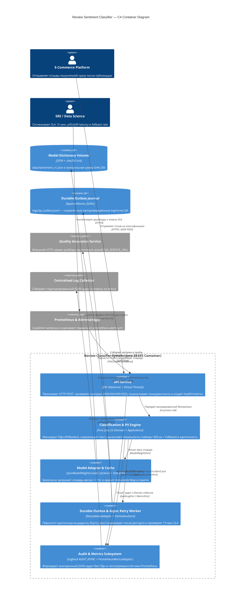

# C4 Container Diagram

Контейнерная диаграмма уровня **C4 Container** показывает внешние акторы, внешние системы и внутренние логические контейнеры (подсистемы) решения, а также протоколы их взаимодействия.

