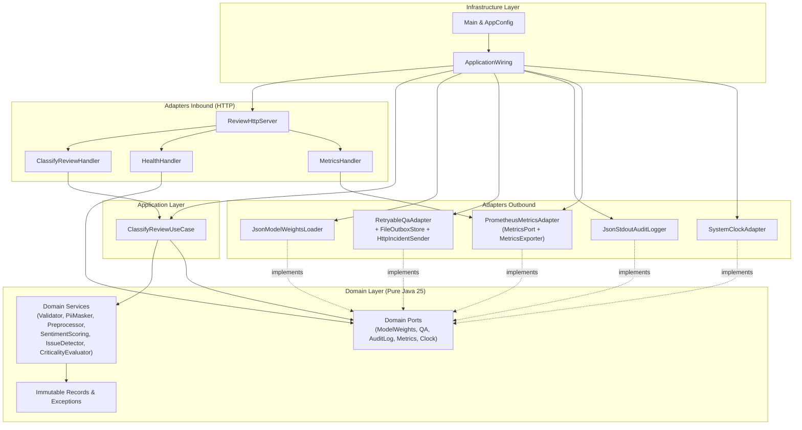

# Clean / Hexagonal Architecture — Layer & Dependency Rule

Стрелки отражают правило зависимостей (Dependency Rule): внешние слои зависят от `application` и `domain`, тогда как `domain` и `application` не имеют зависимостей от фреймворков, HTTP и Jackson.

