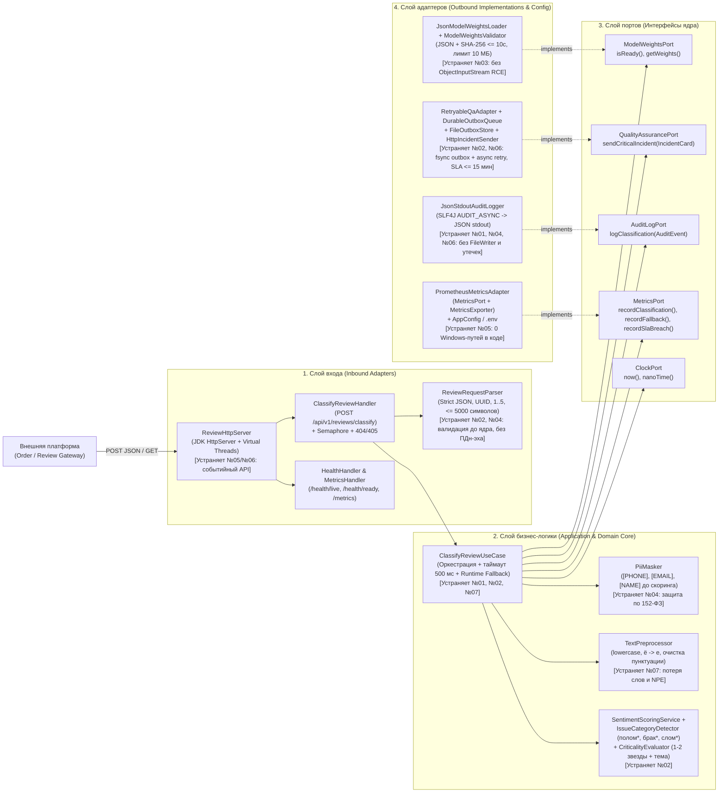

# Схема слоёв (Layered Architecture)

Целевая 4-слойная архитектура сервиса **Review Classifier** разделяет ответственность по принципам Clean / Hexagonal Architecture (зависимости направлены строго к бизнес-ядру) и устраняет все 7 проблем исходного прототипа `ReviewClassifier.java` (зафиксированных в [1.xlsx](artifacts/1.xlsx)).

## Трассировка устранения проблем исходного прототипа (`ReviewClassifier.java` -> Целевая архитектура)

| № (из ДЗ №1) | Проблема прототипа `ReviewClassifier.java` | Где и как устраняется в архитектуре |
|---|---|---|
| **№01** | Ошибка компиляции: `FileWriter` в `classify()` бросал проверяемый `IOException` без обработки | `FileWriter` полностью удалён. `ClassifyReviewUseCase` не выполняет I/O и обращается только к `AuditLogPort`; реализация `JsonStdoutAuditLogger` безопасно пишет однострочный JSON в асинхронный `AUDIT_ASYNC` (`stdout`). |
| **№02** | Игнорирование оценки `1..5`, тем «брак»/«не доставили» и отсутствие отправки критических обращений в Службу качества | `ReviewRequestParser` + `ReviewValidator` валидируют `rating (1..5)` и `createdAt`; `IssueCategoryDetector` распознаёт стемы `брак*`, `слом*`, `полом*`, `дефект*`, `неисправ*`, `опозда*`, `задерж*`, `не достав*`, `не привез*`; `CriticalityEvaluator` + `QualityAssurancePort` (`RetryableQaAdapter`) гарантированно доставляют критичные инциденты. |
| **№03** | Небезопасная десериализация `ObjectInputStream` (`readObject()` -> риск RCE CWE-502, `ClassNotFoundException`) | Заменена в адаптере `JsonModelWeightsLoader` на строгий разбор JSON (`sentiment_v1.json`) с проверкой целостности `SHA-256` (`MessageDigest.isEqual`), проверкой на `Double.isFinite`, лимитом размера 10 МБ и бюджета загрузки `<= 10 с`. |
| **№04** | Утечка ПДн (`System.out.println` + `C:\logs\reviews.log` открытым текстом, нарушение 152-ФЗ) | `System.out` запрещён правилом Checkstyle. `PiiMasker` первым шагом до токенизатора, лога и QA заменяет телефоны, email и имена на `[PHONE]`, `[EMAIL]`, `[NAME]`; `ReviewRequestParser` не отражает сырые значения в ответах `400`. |
| **№05** | Хардкод Windows-путей (`C:\models\sentiment_v1.bin`, `C:\logs\reviews.log`) и отсутствие сети | `AppConfig` + `DotEnvLoader` загружают пути и таймауты из ENV / `.env`; добавлен событийный HTTP-сервер `ReviewHttpServer` (JDK `HttpServer` + Virtual Threads) с эндпоинтами `/api/v1/reviews/classify`, `/health/*`, `/metrics`. |
| **№06** | Утечка дескрипторов и блокирующий дисковый I/O на каждый запрос (`new FileWriter` без `try-with-resources`) | Запись логов вынесена в асинхронный потокобезопасный `AsyncAppender` Logback; запись в `FileOutboxStore` использует `try-with-resources` с `FileChannel.force(true)` только при необходимости буферизации, а ретраи QA работают асинхронно вне потока запроса. |
| **№07** | Потеря ключевых слов при `split(" ")` («ужасный,», «день!», регистр, `ё`) и `NullPointerException` при `null` | `TextPreprocessor` безопасно обрабатывает `null`, переводит в нижний регистр, заменяет `ё -> е`, очищает пунктуацию и возвращает чистые токены, а `ClassifyReviewUseCase` дополнительно защищён от сбоя/таймаута модели (`500 мс`) через Runtime Fallback. |
